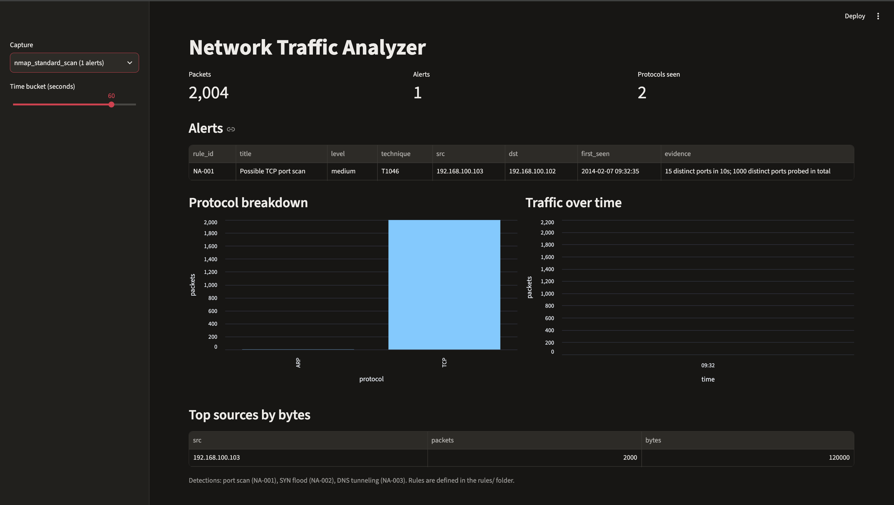

# Network Traffic Analyzer

A Python tool that reads packet captures (.pcap), summarizes the traffic, and flags suspicious activity with rule files. Each rule is a YAML file mapped to a MITRE ATT&CK technique, and each detector is tested against labeled captures.

## What it does

- Parses a capture into a table with Scapy and pandas
- Summarizes protocol breakdown, top sources by packets and bytes, and traffic per minute
- Runs three detections: TCP port scans, SYN floods, and DNS tunneling
- Checks the detectors against labeled captures
- Creates synthetic attack and benign captures for testing
- Stores the results into SQLite
- Shows the results in Streamlit Dashboard

## Detections

| Rule | Detects | ATT&CK | How it works |
|------|---------|--------|--------------|
| NA-001 | TCP port scan | T1046 | One source sends SYN packets to 15 or more distinct ports on one host within 10 seconds |
| NA-002 | SYN flood | T1498 | 100 or more connection attempts to one service within 5 seconds that never complete |
| NA-003 | DNS tunneling | T1071.004 | One host sends 10 or more long, high-entropy subdomains under one parent domain |

Rules live in `rules/` as YAML, so thresholds can be changed without touching code.

## Results

Real captures: public Nmap captures from the Wireshark sample captures page, graded against the authors' README.

The port scan rule flagged 3 of 3 multi-port scans with the correct attacker and target, and raised no false alarms on benign traffic. Across all 6 attack captures, coverage is 3 of 6. The misses are known blind spots (see Limitations). This is a small sample, so these are first results, not an accuracy claim.

## Limitations

- Port scan rule: single-port probes, slow scans that stay under the threshold, and scans with spoofed or bounced sources are not caught
- SYN flood rule: assumes the capture contains both directions of traffic
- DNS rule: uses the last two labels as the parent domain (breaks for names like example.co.uk), has no allowlist for CDNs that use random-looking names, and cannot see encrypted DNS
- Thresholds are placeholders tuned on a small set of captures
- Storage keeps every packet, so very large captures would make the database large; a production tool would store flows or summaries instead

## Quick start

Requires Python 3.10 or newer.

    git clone https://github.com/GurshanSidhuDEV/netanalyzer.git
    cd netanalyzer
    python3 -m venv .venv
    source .venv/bin/activate
    pip install -r requirements.txt
    pip install -e .
    pytest

Analyze a capture:

    python3 -m netanalyzer.cli data/sample_small.pcap

Generate the synthetic captures and score the detectors:

    python3 -m netanalyzer.synth
    python3 -m netanalyzer.evaluate

Store results in SQLite and open the dashboard (the synthetic captures must already exist from the step above):

    pip install -e ".[dashboard]"
    python3 -m netanalyzer.save_captures data/sample_small.pcap data/synthetic/*
    streamlit run src/netanalyzer/dashboard.py

Query the stored results (the sqlite3 command-line tool comes preinstalled on macOS):

    sqlite3 -header -column netanalyzer.db "SELECT rule_id, src, dst, evidence FROM alerts;"

The Nmap captures are not included in this repo. To reproduce the real-capture results, download "NMap Captures.zip" from the Wireshark sample captures page (wiki.wireshark.org/SampleCaptures) and unzip it into `data/nmap/`. Then run `python3 -m netanalyzer.batch data/nmap/*`. The sample capture `data/sample_small.pcap` is SkypeIRC.cap from the same page.
